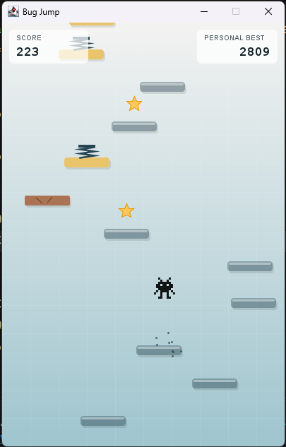
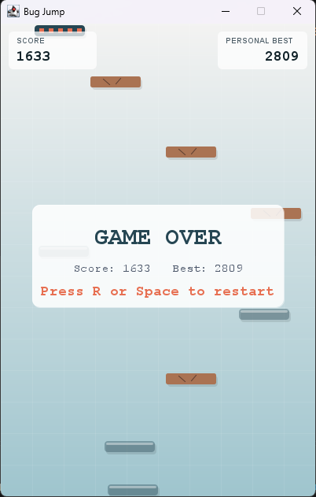

# 🐞 Bug Jump — Enhanced Vertical Platformer

<p align="center">
  <strong>A fun, lightweight vertical platformer built with Java Swing and AWT.</strong>
  <br/>
  Jump higher, collect stars, ride moving platforms, use spring boosts, and avoid crumbling platforms!
</p>

<p align="center">
  
  
  
  
  
</p>

---

## 📸 Preview

<p align="center">
  <!-- Replace these placeholders with actual screenshots from your game. -->
  
  
</p>

<p align="center">
  <em>Gameplay and game-over screenshots — replace the placeholders with your own screenshots.</em>
</p>

---

## 📖 Table of Contents

- [🎮 About the Game](#-about-the-game)
- [✨ Features](#-features)
- [🕹️ Controls](#️-controls)
- [🧩 Platform Types](#-platform-types)
- [⭐ Scoring System](#-scoring-system)
- [🛠️ Technologies Used](#️-technologies-used)
- [🚀 Getting Started](#-getting-started)
- [📂 Project Structure](#-project-structure)
- [⚙️ How It Works](#️-how-it-works)
- [💾 High Score Storage](#-high-score-storage)
- [💡 Gameplay Tips](#-gameplay-tips)
- [🔮 Future Improvements](#-future-improvements)
- [📚 Learning Outcomes](#-learning-outcomes)
- [🤝 Contributing](#-contributing)
- [📄 License](#-license)

---

## 🎮 About the Game

**Bug Jump** is a 2D vertical platformer developed using Java Swing and Java AWT.

The objective is simple: keep jumping from platform to platform, climb as high as possible, collect stars, and achieve the highest score.

The game features different platform types, smooth camera scrolling, particle effects, combo-based rewards, and increasing difficulty as you progress.

It is designed as a lightweight desktop game that runs without external libraries or image assets.

## ✨ Features

<table>
  <tr>
    <td width="50%">
      <h3>🎯 Core Gameplay</h3>
      <ul>
        <li>Automatic bouncing when landing on platforms</li>
        <li>Smooth vertical camera scrolling</li>
        <li>Horizontal screen wrapping</li>
        <li>Responsive keyboard controls</li>
      </ul>
    </td>
    <td width="50%">
      <h3>🧩 Platform Mechanics</h3>
      <ul>
        <li>Standard platforms</li>
        <li>Moving platforms</li>
        <li>Spring-powered platforms</li>
        <li>Crumbling platforms</li>
      </ul>
    </td>
  </tr>
  <tr>
    <td>
      <h3>⭐ Rewards & Effects</h3>
      <ul>
        <li>Collectible stars</li>
        <li>Star combo system</li>
        <li>Bonus score rewards</li>
        <li>Landing and collection particles</li>
      </ul>
    </td>
    <td>
      <h3>🎨 Visual Experience</h3>
      <ul>
        <li>Custom pixel-art player sprite</li>
        <li>Gradient background</li>
        <li>Animated stars</li>
        <li>Polished HUD and game screens</li>
      </ul>
    </td>
  </tr>
  <tr>
    <td>
      <h3>📈 Progression</h3>
      <ul>
        <li>Progressively increasing difficulty</li>
        <li>Increasing platform gaps</li>
        <li>More challenging platform combinations</li>
      </ul>
    </td>
    <td>
      <h3>💾 Game Management</h3>
      <ul>
        <li>Start, pause, and restart</li>
        <li>Persistent personal best score</li>
        <li>Safe handling of invalid high-score data</li>
      </ul>
    </td>
  </tr>
</table>

<details>
<summary><strong>🔍 Explore the enhanced gameplay features</strong></summary>

### 🪨 Crumbling Platforms

Some platforms cannot support the player for long.

- They begin crumbling when the player lands on them.
- A short countdown starts.
- After approximately 28 game frames, the platform disappears.

### ✨ Particle Effects

The game generates small animated particles to make important actions more satisfying.

- Landing on a platform creates a particle burst.
- Collecting a star creates a larger golden particle effect.
- Particles gradually fade and disappear.

### ⭐ Star Combo System

Collect stars quickly to build a combo.

- Each star gives 50 bonus points.
- Collecting another star within approximately 240 game frames continues the combo.
- Each additional star in the active combo adds 10 points to the combo bonus.
- The combo resets when the time window expires.

### 📈 Progressive Difficulty

The game becomes more challenging as the player climbs.

- Platform gaps gradually increase.
- Moving platforms become more frequent.
- Crumbling platforms become more frequent.
- Platform generation adapts to the player's height.

</details>

---

## 🕹️ Controls

| Key | Action |
|---|---|
| ← / → | Move left or right |
| A / D | Alternative movement controls |
| Space | Start or restart |
| Enter | Start or restart |
| P | Pause or resume |
| R | Restart after game over |
| Esc | Quit the game |

<details>
<summary><strong>💡 How to play</strong></summary>

1. Press **Space** or **Enter** to start.
2. Use the arrow keys or A/D to move.
3. Land on platforms to bounce automatically.
4. Use spring platforms to jump higher.
5. Collect stars to earn bonus points and build combos.
6. Watch out for crumbling platforms.
7. Keep climbing and try to beat your personal best!

</details>

---

## 🧩 Platform Types

The game includes four different platform types.

| Platform | Description |
|---|---|
| 🟦 Standard | Regular platforms that provide normal bouncing. |
| ↔️ Moving | Platforms that move horizontally and reverse direction at screen edges. |
| 🟨 Spring | Platforms that provide a stronger upward bounce. |
| 🟫 Crumbling | Platforms that disappear shortly after the player lands on them. |

---

## ⭐ Scoring System

Your score is based on climbing height, collected stars, and active star combos.

| Action | Points |
|---|---:|
| Climbing | 1 point per 10 pixels |
| Collecting a star | +50 |
| Each additional star in an active combo | +10 combo bonus |

The score combines all three rewards.

The highest score is saved locally and displayed as your personal best.

---

## 🛠️ Technologies Used

| Technology | Purpose |
|---|---|
| Java 8+ | Programming language |
| Java Swing | Game window, panel, and timer |
| Java AWT | Graphics, colors, keyboard input |
| Java 2D | Custom drawing and particle effects |
| Java Collections | Managing platforms and particles |
| Java NIO | Saving and loading high scores |

**No external libraries or image assets are required.**

---

## 🚀 Getting Started

### Prerequisites

- Java Development Kit (JDK) 8 or later
- Any Java IDE, such as:
  - IntelliJ IDEA
  - Eclipse
  - NetBeans
  - VS Code
  - Code::Blocks is not suitable for compiling this Java project.

### 1. Clone the repository

```bash
git clone https://github.com/royavi21/Bug-Jump.git
```

### 2. Open the project directory

```bash
cd Bug-Jump
```

### 3. Compile the source code

```bash
javac BugJump.java
```

### 4. Run the game

```bash
java BugJump
```

That's it! Enjoy playing Bug Jump. 🐞

---

## 📂 Project Structure

```text
Bug-Jump/
│
├── BugJump.java
├── README.md
│
└── screenshots/
    ├── gameplay.png
    └── game-over.png
```

The game is implemented in a single Java source file. The `screenshots` directory is optional and is used for README previews.

---

## ⚙️ How It Works

The game uses a Swing Timer to update the game state and repaint the screen approximately every 16 milliseconds.

### 🎯 Game Loop

### 🎯 Game Loop

The game continuously repeats the following steps while running:

```text
       ┌──────────────────────┐
       │      Game Starts     │
       └──────────┬───────────┘
                  │
                  ▼
       ┌──────────────────────┐
       │   Read Player Input  │
       │    (Left / Right)    │
       └──────────┬───────────┘
                  │
                  ▼
       ┌──────────────────────┐
       │   Update Player      │
       │   Position & Physics │
       │   (Movement/Gravity) │
       └──────────┬───────────┘
                  │
                  ▼
       ┌──────────────────────┐
       │   Update Platforms   │
       │  (Moving/Crumbling)  │
       └──────────┬───────────┘
                  │
                  ▼
       ┌──────────────────────┐
       │  Check Collisions    │
       │  & Automatic Bounce  │
       └──────────┬───────────┘
                  │
                  ▼
       ┌──────────────────────┐
       │  Collect Stars &     │
       │  Update Combo Score  │
       └──────────┬───────────┘
                  │
                  ▼
       ┌──────────────────────┐
       │  Update Particles    │
       │  & Camera Position   │
       └──────────┬───────────┘
                  │
                  ▼
       ┌──────────────────────┐
       │   Update Score &     │
       │   Check Game Over    │
       └──────────┬───────────┘
                  │
                  ▼
       ┌──────────────────────┐
       │    Render Screen     │
       │  (Player, Platforms, │
       │   Effects & HUD)     │
       └──────────┬───────────┘
                  │
                  └───────────────↻
```

The loop runs approximately every **16 milliseconds** using a Java Swing Timer (around 60 updates per second).

When the game is paused, gameplay updates stop, but the screen continues to repaint. When the player falls below the screen, the game enters the Game Over state.

### 🧠 Main Components

| Component | Responsibility |
|---|---|
| `BugJump` | Main game panel and game logic |
| `Platform` | Stores platform position, type, and state |
| `Particle` | Stores particle position, velocity, color, and lifetime |
| `State` | Manages START, PLAYING, PAUSED, and GAME_OVER |
| `PType` | Defines the four platform types |

### ⚡ Physics and Movement

The game uses simple velocity-based physics.

- Gravity continuously increases the player's downward velocity.
- Landing on a platform resets the vertical velocity.
- Spring platforms apply a stronger upward velocity.
- Horizontal movement is controlled by keyboard input.
- The camera follows the player when they reach the scrolling threshold.

### 🎨 Graphics and Rendering

The game uses Java 2D to draw its graphics programmatically.

- Pixel-art player sprite.
- Gradient background and subtle grid.
- Custom platform designs.
- Animated collectible stars.
- Particle effects.
- Translucent HUD and game-state panels.

No external image files are needed to render the game itself.

---

## 💾 High Score Storage

Bug Jump automatically saves the highest score on the local computer.

The high-score file is stored in the user's home directory:

```text
~/.bugjump_hi
```

The game uses Java NIO file operations to read and write the score.

Invalid or negative saved scores are handled safely.

---

## 💡 Gameplay Tips

<details>
<summary><strong>🏆 Tips to achieve a higher score</strong></summary>

- **Plan your movement:** Look ahead before moving toward the next platform.
- **Use springs:** Take advantage of their stronger bounce to reach higher platforms.
- **Collect stars:** Each star gives 50 bonus points.
- **Build combos:** Collect stars within the combo time window to earn extra points.
- **Watch crumbling platforms:** Do not rely on them for a second landing.
- **Be careful with moving platforms:** Time your landing based on their direction.
- **Stay focused:** Platform gaps and difficulty increase as you climb.

</details>

---

## 🔮 Future Improvements

Here are some ideas that could make Bug Jump even better:

- [ ] Multiple player skins
- [ ] Sound effects and background music
- [ ] Main menu with game settings
- [ ] Difficulty selection
- [ ] Power-ups and shields
- [ ] Additional platform types
- [ ] More background themes
- [ ] Animated player movement
- [ ] Local leaderboard with multiple scores
- [ ] Game statistics and achievements

---

## 📚 Learning Outcomes

This project demonstrates practical Java programming concepts, including:

- Object-oriented programming
- Java Swing GUI development
- Java AWT graphics and event handling
- Keyboard input using Key Bindings
- Game loops and timer-based updates
- Basic 2D physics and collision detection
- Randomized object generation
- Java Collections and object management
- Particle systems and animation
- File handling using Java NIO

---

## 🤝 Contributing

Contributions, suggestions, and improvements are welcome!

1. Fork the repository.
2. Create a new branch.
3. Make your changes.
4. Test the game.
5. Submit a pull request.

Feel free to report bugs or suggest new features through GitHub Issues.

---

## 📄 License

This project is available for personal learning and educational purposes.

If you want to distribute it as an open-source project, add a suitable `LICENSE` file to the repository and update this section accordingly.

---
## 👨‍💻 Author

**Avijit Roy**

- GitHub: [@royavi21](https://github.com/royavi21)

<p align="center">
  <strong>🐞 Keep jumping. Keep climbing. Beat your best score!</strong>
  <br/>
  Made with ❤️ and Java.
</p>